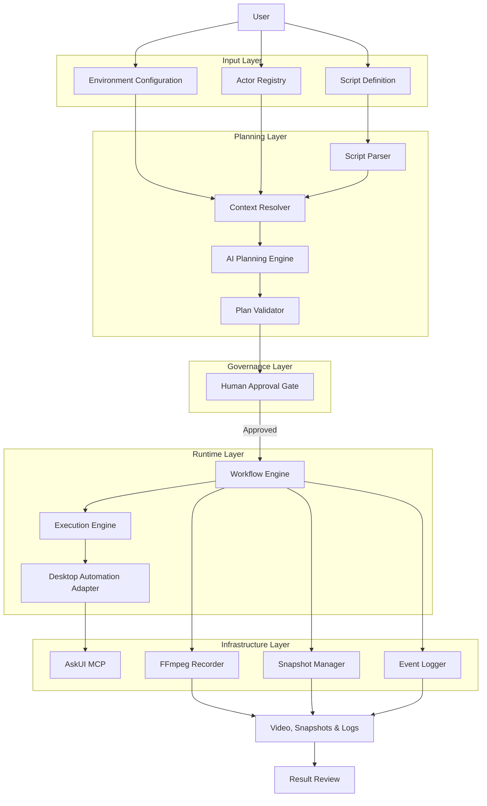
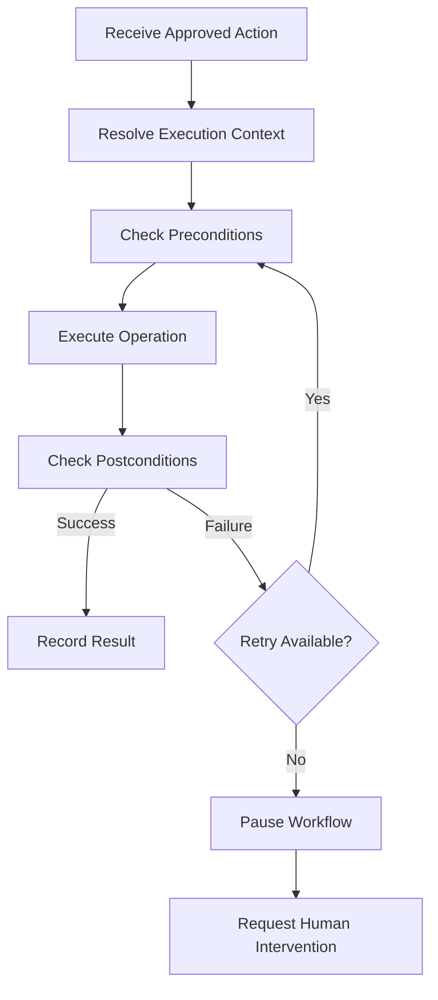
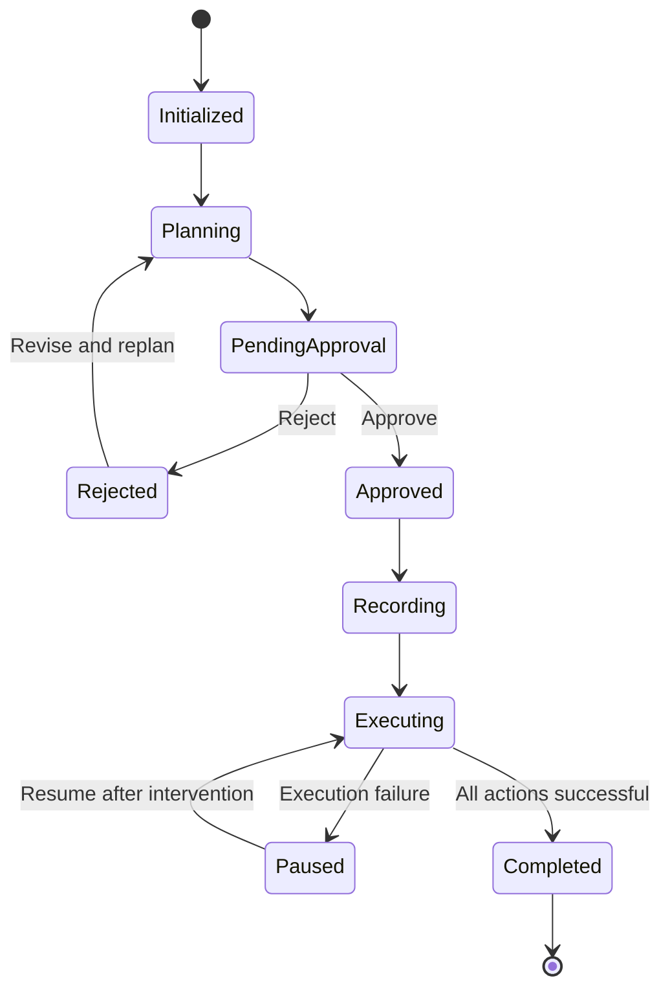

# Demouli — Technical Architecture

> Technical Design & Engineering Decisions

## 1. Architecture Overview

Demouli is a script-driven desktop automation system designed for software demo production.

Its architecture separates planning, workflow orchestration, and execution to establish clear responsibilities and predictable control boundaries.

### High-level Architecture



## 2. Core Domain Model

The system is built around six primary domain concepts:

- Environment
- Actor
- Application
- Script
- Action
- Snapshot

These concepts should be defined independently of the underlying automation framework.

### 2.1 Environment

Environment describes the runtime resources available to a recording session.

Responsibilities:

- Define available applications.
- Define application launch configurations.
- Define desktop automation capabilities.
- Provide execution-level configuration.

Example:

```yaml
environment:
  id: local_demo
  capture:
    viewport:
      width: 1280
      height: 800
  applications:
    - browser
    - terminal
```

`capture.viewport` is the frame used for every showcase snapshot. A fixed viewport keeps images from the same script comparable across runs.

### 2.2 Application

Application represents an executable software application.

It contains the information required to launch and interact with the application.

Example:

```yaml
applications:
  browser:
    name: Google Chrome
    launch:
      command: "google-chrome"
    capabilities:
      - navigate
      - click
      - type
      - screenshot
```

The application registry is predefined in the MVP.

Automatic discovery of all installed applications is out of scope.

### 2.3 Actor

Actor represents a logical participant in a demonstration.

An actor provides the execution context for a sequence of operations.

Responsibilities:

- Identify the logical participant.
- Define associated applications.
- Bind application sessions or windows.
- Provide role-specific context to the Planning Engine.

Example:

```yaml
actors:
  customer:
    description: "E-commerce customer"
    applications:
      browser:
        session: customer_session
        window: customer_browser

  admin:
    description: "Store administrator"
    applications:
      browser:
        session: admin_session
        window: admin_browser
```

Important design decisions:

1. Actors are explicitly defined by users.
2. Scripts reference actors through stable actor IDs.
3. Actor-to-application relationships are configured before execution.
4. The AI may interpret actor context but must not independently reassign application sessions or windows.
5. Multiple actors may share an application type while using different sessions or windows.

Actor and Application are separate domain concepts. They should not be treated as interchangeable.

### 2.4 Script

Script describes the demonstration scenario.

It is the primary input for the Planning Engine.

Example:

```yaml
metadata:
  id: ecommerce_demo
  name: E-commerce Workflow Demo
  version: 1.0

steps:
  - id: step_001
    actor: customer
    description: "Open the product page"
    action: navigate
    target: product_page

  - id: step_002
    actor: customer
    description: "Add the product to the cart"
    action: click
    target: add_to_cart
    capture:
      name: cart
      caption: "Product added to the cart"

  - id: step_003
    actor: admin
    description: "Open order management"
    action: click
    target: order_management
```

A script should describe the intended demonstration rather than low-level desktop implementation details.

The Planning Engine is responsible for translating script intent into executable operations.

A step may declare `capture`. That declaration marks a moment worth keeping as a named project snapshot. It does not itself perform the click or navigation. The Planning Engine appends a `capture` action after the step, and that action runs only when the step's postconditions pass. Capture names are unique within a script.

### 2.5 Action

Action represents an atomic executable operation.

An action should have a standardized schema.

Proposed structure:

```yaml
id: action_001

actor: customer
application: browser

operation: click

target:
  id: add_to_cart
  description: "Add to Cart button"

preconditions:
  - product_page_loaded

postconditions:
  - cart_updated

retry:
  max_attempts: 2
```

The exact schema will be refined during implementation.

An action should be independently identifiable, executable, and traceable.

A showcase capture is an action in the approved plan:

```yaml
id: action_002

actor: customer
application: browser

operation: capture

target:
  window: customer_browser

capture:
  name: cart
  caption: "Product added to the cart"

preconditions:
  - cart_updated
```

The capture writes one image of that actor's application window, using the environment viewport. It does not capture the whole desktop.

### 2.6 Snapshot

A snapshot is the image produced by a successful `capture` action.

Responsibilities:

- Represent one named, successful step outcome.
- Stay associated with the actor, step, caption, and video timestamp.
- Remain reproducible when the same script runs again.

A snapshot is an output of the session, not a second way to take arbitrary screenshots. Images captured after a failed action are diagnostic files. They are stored with the event log and are excluded from the snapshot set.

## 3. System Components

### 3.1 Script Parser

Responsibilities:

- Load YAML scripts.
- Validate script structure.
- Validate referenced actor IDs.
- Validate referenced application configurations.
- Convert scripts into internal representations.

The parser should reject structurally invalid scripts before AI planning begins.

### 3.2 Context Resolver

Responsibilities:

- Resolve actor references.
- Retrieve actor application bindings.
- Resolve available application capabilities.
- Build the execution context for each script step.

The Context Resolver provides explicit context to the Planning Engine.

It does not make autonomous environment or session assignments.

### 3.3 Planning Engine

The Planning Engine converts the structured script into an executable plan.

Responsibilities:

- Understand script intent.
- Interpret actor and application context.
- Select supported operations.
- Generate action parameters.
- Define validation requirements.
- Append a `capture` action for each step that declares `capture`.
- Produce a structured execution plan.

The Planning Engine should use a constrained action schema rather than unrestricted natural-language instructions.

The generated plan must pass schema and reference validation before approval.

### 3.4 Plan Validator

Responsibilities:

- Validate action structure.
- Check action parameters.
- Verify actor and application references.
- Verify that requested capabilities are supported.
- Check execution dependencies.
- Require unique capture names and a resolvable actor window for every `capture` action.
- Require `capture.viewport` when the plan contains a capture.
- Detect unsupported or ambiguous operations.

The validator should reject invalid plans rather than silently modifying critical execution decisions.

### 3.5 Human Approval Gate

The approval gate separates planning from execution.

Users review:

- Actor assignments.
- Application context.
- Operation sequence.
- Action parameters.
- Target elements.
- Preconditions and postconditions.
- Snapshot names, captions, and the windows they capture.
- Potentially risky operations.

Possible outcomes:

- Approved.
- Rejected.
- Modified and resubmitted.

Only approved plans can enter the execution workflow.

### 3.6 Workflow Engine

The Workflow Engine manages the lifecycle of a recording session.

Responsibilities:

- Manage workflow state.
- Enforce approval requirements.
- Coordinate recording and execution.
- Apply retry policies.
- Handle interruptions.
- Track execution progress.
- Persist workflow events.

The Workflow Engine is the central controller of the runtime process.

### 3.7 Execution Engine

The Execution Engine performs the approved actions.

Each action follows a controlled execution sequence:



Key constraints:

- Execute only approved actions.
- Do not autonomously rewrite the entire execution plan.
- Validate application state before and after important operations.
- Apply bounded retries.
- Pause when an action cannot be completed.
- Record execution results and failure information.

A fixed execution plan does not guarantee deterministic GUI outcomes. The system improves reliability through validation, controlled retries, and interruption policies.

### 3.8 Desktop Automation Adapter

Provides an abstraction between the Execution Engine and desktop automation tools.

Initial implementation:

- AskUI MCP.

Potential alternative:

- Peekaboo.

The adapter should expose a consistent interface for operations such as clicking, typing, navigating, waiting, and observing application state.

This reduces coupling between the execution architecture and a specific automation provider.

### 3.9 Recording Manager

Uses FFmpeg to capture the desktop session.

Responsibilities:

- Start recording.
- Stop recording.
- Manage recording output paths.
- Associate recordings with workflow sessions.
- Record start and end timestamps.

Recording should be coordinated by the Workflow Engine.

### 3.10 Snapshot Manager

Writes showcase snapshots for approved `capture` actions.

Responsibilities:

- Capture the actor's application window after the capture preconditions pass.
- Use the environment viewport.
- Name files from script order and the capture name, such as `02-cart.png`.
- Record the video timestamp of the capture.
- Refuse to write a showcase snapshot when the preconditions fail.

A diagnostic image taken during failure handling is stored separately and is not registered as a snapshot.

### 3.11 Session Result Review

Presents one finished session to the operator before anything is treated as the published set.

The review is a single line, in script order. Successful snapshots hang with their step names. The session recording hangs on the same line with a play control. The gesture model follows a hanging capture line, in the spirit of [Tendedero](https://github.com/alejandrobujan/tendedero), and applies only to this session result.

| Gesture | Snapshot | Recording |
|---|---|---|
| Click | Copy the image | Play it in place |
| Drag into a directory | Mark it published | Mark it published |
| Click the cross | Mark it unpublished | Mark it unpublished |
| Press and hold | Open the system markup tool and save back under the same capture name | No action |

Unpublished files remain in the session directory. Diagnostic images do not hang on the line. The recording cannot be trimmed here. Trimming stays in post-production.

The line is drawn by Demouli for the finished session. It does not install a menu-bar overlay, watch the operating system's screenshot folder, suppress the system screenshot thumbnail, or ingest copied images.

Selection updates the session manifest. It does not modify the approved plan or re-enter execution.

The result line is available once the workflow reaches `Completed`. A paused or failed session keeps its files and events, and does not open the line.

### 3.12 Event Logger

Records the lifecycle of a recording session.

Example:

```json
{
  "session_id": "session_001",
  "event": "action_completed",
  "action_id": "action_001",
  "actor_id": "customer",
  "timestamp": "2026-01-01T10:00:00Z",
  "duration_ms": 1200,
  "status": "success"
}
```

The event log should support:

- Execution debugging.
- Failure analysis.
- Video timestamp alignment.
- Performance measurement.
- Future automated post-production.

## 4. Execution Workflow

The complete runtime process is divided into distinct stages.

### Stage 1 — Configuration

Load:

- Environment configuration.
- Application registry.
- Actor definitions.
- Script definition.

### Stage 2 — Parsing & Context Resolution

Parse the script and resolve actor and application references.

Invalid references should be rejected before planning.

### Stage 3 — AI Planning

Generate a structured execution plan using:

- Script content.
- Actor definitions.
- Application capabilities.
- Execution constraints.

### Stage 4 — Plan Validation

Validate the generated plan against the internal action schema and available execution capabilities.

### Stage 5 — Human Approval

Present the execution plan for review.

Execution cannot begin without approval.

### Stage 6 — Recording & Execution

1. Initialize the recording session.
2. Start FFmpeg recording.
3. Execute approved actions in sequence.
4. Validate preconditions and postconditions.
5. Record execution events.
6. Write a showcase snapshot when a `capture` action's preconditions pass.
7. Retry failed actions within the configured limit.
8. On failure, store a diagnostic image when possible. Do not register it as a snapshot.
9. Pause the workflow when recovery is not possible.
10. Stop recording when execution finishes or is interrupted.

### Stage 7 — Output Generation

Generate:

- Raw demo video.
- Showcase snapshots for successful captures.
- Session manifest.
- Execution event log.
- Workflow execution report.

### Stage 8 — Result Review

When the workflow is `Completed`, present the result line.

The operator publishes or sets aside the recording and each successful snapshot. The manifest records that choice. Markup may replace a snapshot file in place. Execution does not resume from this stage.

### Stage 9 — Post-production

Future versions may use video timestamps and execution events to perform automated video processing.

## 5. Workflow State Management

The Workflow Engine should use an explicit state machine.

Proposed states:



Additional terminal or failure states can be introduced as needed:

- Cancelled
- Failed
- Interrupted

The MVP should keep the state model small and explicit. Reaching `Completed` opens the result line. Publishing or setting aside an output updates the session manifest and does not add another workflow state.

## 6. Failure Handling

Desktop automation is inherently affected by external application state.

Potential failure scenarios:

- Application fails to launch.
- Target element cannot be located.
- Page or component has not finished loading.
- Click operation does not produce the expected result.
- Unexpected dialogs or overlays appear.
- Actor session or window cannot be resolved.

### Retry Policy

Retries must be bounded.

Proposed MVP policy:

- Maximum two attempts per action.
- Retry only when the failure is considered recoverable.
- Recheck preconditions before retrying.
- Record every attempt.
- Pause after the retry limit is reached.

### Failure Policy

The system must not enter an uncontrolled replanning loop.

When execution fails:

1. Record the failure.
2. Store a diagnostic image of the actor's application window when possible. The image is not a showcase snapshot, does not appear on the result line, and is not published.
3. Pause the workflow.
4. Request human intervention.

Human intervention may include correcting the application state, modifying the script, or restarting the recording session.

## 7. Recording & Event Tracking

Video recording and action execution must share a common session identifier.

Proposed output structure:

```text
output/
  ecommerce_demo/
    session_001/
      recording.mp4
      events.jsonl
      execution-report.json
      plan.json
      manifest.json
      snapshots/
        01-product-page.png
        02-cart.png
        03-admin-orders.png
      diagnostics/
        action_004-attempt-2.png
```

`manifest.json` lists the recording and every showcase snapshot. `published` records the operator's choice during result review. `video_offset_ms` aligns a snapshot with the recording.

```json
{
  "session_id": "session_001",
  "items": [
    {
      "type": "snapshot",
      "name": "cart",
      "step_id": "step_002",
      "actor_id": "customer",
      "caption": "Product added to the cart",
      "file": "snapshots/02-cart.png",
      "video_offset_ms": 8400,
      "published": true
    },
    {
      "type": "video",
      "name": "recording",
      "file": "recording.mp4",
      "published": true
    }
  ]
}
```

Diagnostic images stay under `diagnostics/` and are referenced by the event log. They are omitted from `manifest.json`.

The event log should contain timestamps that can be aligned with the recording and with each snapshot.

This establishes the foundation for result review and for future post-production. The published set is the recording and snapshot files whose manifest entries are `published`. The result line is the operator's view of that choice. An external audience receives those files, not the review surface.

## 8. Technology Decisions

| Area | Proposed Technology | Reason |
|---|---|---|
| Primary Language | TypeScript | Application logic and structured orchestration |
| Supporting Language | Python | Optional media-processing tasks |
| Script Format | YAML | Readable and structured configuration |
| AI Planning | LLM API | Interpret scripts and generate plans |
| Desktop Automation | AskUI MCP | Visual desktop interaction |
| Workflow Orchestration | Harness | Tool orchestration and execution control |
| Recording | FFmpeg | Desktop video capture |
| Validation | Schema-based validation | Ensure structured and valid plans |
| Logging | JSON / JSONL | Structured event tracking |

These are proposed choices. Final technology selection should follow implementation experiments and integration requirements.

## 9. Engineering Constraints

The following constraints define the system's intended behavior.

| Constraint | Design Decision |
|---|---|
| Role assignment | Explicitly configured by users |
| Application selection | Based on predefined application registry |
| Actor context | Resolved before execution |
| AI planning | Generates structured plans |
| Plan execution | Requires human approval |
| Execution strategy | Fixed approved plan |
| GUI failure | Bounded retries |
| Retry exhaustion | Pause and request intervention |
| Global replanning | Not allowed during normal execution |
| Recording | Coordinated with workflow lifecycle |
| Showcase snapshot | Taken only after the declaring step's postconditions pass, from the actor's window |
| Diagnostic image | Kept in the event log and excluded from the published set |
| Result review | Selects published outputs after completion and does not change the approved plan |
| Observability | Every action and state transition is logged |

## 10. Scope Management

### MVP — Essential Capabilities

The MVP should prove that a structured script can be transformed into an approved plan and executed to produce a usable demonstration recording and the named snapshots declared in that script.

Required:

- Environment configuration.
- Application registry.
- Actor registry.
- YAML script parser.
- AI Planning Engine.
- Action schema and plan validation.
- Human approval.
- Workflow state management.
- Desktop automation adapter.
- FFmpeg recording.
- Named snapshot capture and session manifest.
- Result review of the recording and successful snapshots.
- Event logging.
- Bounded retry and interruption.

### Engineering Improvements

After the core workflow works:

- Better precondition and postcondition checks.
- Improved recovery and resume behavior.
- Execution reports.
- Performance metrics.
- Reliability tests.
- Comparison against alternative automation strategies.

### Future Extensions

Not required for MVP:

- Automated video editing.
- TTS narration.
- Automatic subtitle generation.
- Advanced visual effects.
- Web management interface.
- Automatic application discovery.
- General-purpose autonomous desktop operation.
- A system-wide screenshot inbox.
- In-place video trimming on the result line.

## 11. Evaluation Metrics

The project should be evaluated through actual recording sessions.

Potential metrics:

| Metric | Purpose |
|---|---|
| Recording Success Rate | Measure execution reliability |
| Average Recording Duration | Measure production efficiency |
| Manual Intervention Count | Measure automation effectiveness |
| Retry Count | Measure GUI interaction stability |
| Planning Token Usage | Measure AI planning cost |
| Total Production Time | Compare against manual recording |
| Reproduction Success Rate | Measure workflow repeatability |

Metrics should be collected from actual experiments rather than estimated.

## 12. Key Engineering Decisions

### Decision 1 — Script-driven rather than autonomous exploration

**Reason:** The objective is to produce a predefined demonstration, not to explore an unknown desktop environment.

### Decision 2 — Explicit Actor Definition

**Reason:** The system needs reliable role and session context when a demonstration involves multiple participants.

### Decision 3 — Planning and Execution Separation

**Reason:** AI-generated plans should be reviewed before interacting with the desktop.

### Decision 4 — Mandatory Human Approval

**Reason:** It provides an explicit control boundary between AI interpretation and real application operations.

### Decision 5 — Fixed Plan with Bounded Recovery

**Reason:** Unrestricted replanning can introduce unpredictable behavior, repeated failures, and unnecessary model costs.

### Decision 6 — Event-based Observability

**Reason:** Execution logs provide traceability, debugging information, and a foundation for timestamp-driven video post-production.

### Decision 7 — Showcase snapshots are declared and gated

**Reason:** A project snapshot has to be a known, successful state with a stable name. Taking a still after postconditions pass keeps the published set aligned with the script. Failure images remain diagnostic and stay out of that set.

### Decision 8 — Result review selects outputs after execution

**Reason:** The operator needs a single place to watch the recording, inspect the snapshots, and decide what is published. That review uses a hanging line of the finished session, including click to copy or play, drag to keep, and cross to set aside. It does not replan, retrim the video, or become a general screenshot tool. External presentation uses the published files.

---

**Core architectural principle:**

> Define the environment and actors explicitly, let AI translate scripts into executable plans, require human approval, and execute through a controlled workflow with bounded failure handling. From the finished session, publish the recording and the named snapshots the operator keeps.