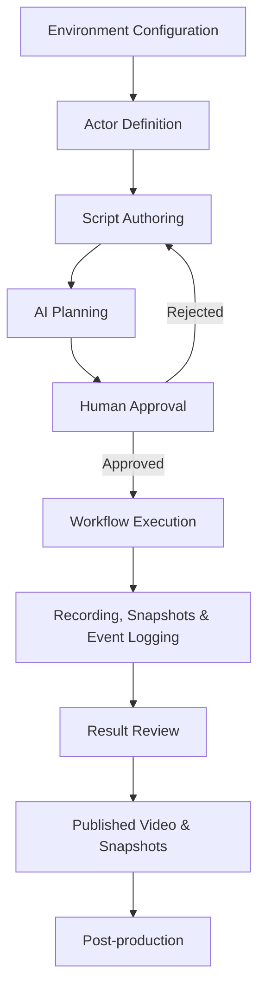

# Demouli

> Script-driven Demo Production System

Demouli is an AI-assisted tool for automating the production of software demonstration videos and named interface snapshots through structured scripts, role-based execution, and human-supervised workflows.

It transforms a predefined demonstration script into an executable workflow, so one run can produce a repeatable demo video and a stable set of project snapshots.

## 1. Overview

### Background

When developing software projects, developers often need to produce demonstration videos to showcase product features, user workflows, and technical capabilities.

Traditional demo recording involves manually operating applications, recording screens, and repeatedly adjusting the recording when something goes wrong.

This process has several problems:

- **Repetitive Operations** — The same demonstration workflow needs to be performed repeatedly.
- **Inconsistent Results** — Manual operations can introduce timing differences and operational mistakes.
- **Recording Overhead** — Developers spend time managing recording sessions rather than focusing on the actual demonstration.
- **Difficult Reproduction** — Reproducing the same demonstration requires manually repeating the entire process.
- **Separate stills** — A project page, README, or release note still needs stable pictures of important states, usually taken by hand outside the recording.

Demouli aims to automate this process through structured scripts and controlled execution. The same run produces the recording and the snapshots declared in the script.

### Core Idea

Demouli follows a human-supervised automation model:

> Humans define the demonstration. AI plans the execution. Humans approve the plan. The system executes the approved workflow.

Instead of allowing an AI Agent to freely operate a desktop, Demouli separates planning from execution and introduces explicit human approval before performing operations.

### Design Principles

1. **Script-driven** — Demonstration workflows are defined through structured scripts.
2. **Role-aware** — Every operation is associated with a predefined actor.
3. **Planning and Execution Separation** — AI generates an execution plan, while the execution engine follows the approved plan.
4. **Human-in-the-Loop** — Users review and approve execution plans before operations begin.
5. **Controlled Execution** — Failed operations follow predefined retry and interruption policies.
6. **Reproducibility** — Scripts, execution plans, event logs, and the snapshot manifest provide a traceable record of each session.
7. **Declared snapshots** — Showcase stills are named in the script and taken only after the corresponding step succeeds.

## 2. Core Concepts

Demouli uses six core concepts to describe a demonstration workflow.

| Concept | Responsibility |
|---|---|
| Environment | Defines the execution environment and available applications |
| Actor | Defines who performs an operation |
| Application | Defines the application in which an operation takes place |
| Script | Defines the demonstration scenario |
| Action | Defines an individual executable operation |
| Snapshot | Defines a named still kept after a successful step |

### Environment

Describes the runtime environment, including available applications, execution tools, and application configurations.

### Actor

Represents a logical participant in a demonstration.

Examples:

- Customer
- Administrator
- Developer
- Guest

Actors allow a script to describe interactions from different user perspectives.

An actor is explicitly configured before script execution. The system does not independently decide which desktop session or application window an actor should use.

### Application

Represents an application that can be controlled by the execution engine.

Examples:

- Browser
- Terminal
- Code Editor
- Desktop Application

An actor can be associated with one or more applications, and multiple actors may use the same application under different session or window contexts.

### Script

Defines the demonstration scenario, including actors, operations, and optional narration.

Scripts provide the primary input for AI planning.

### Action

Represents an atomic operation that can be executed by the system.

Examples:

- Click an element
- Enter text
- Navigate to a URL
- Wait for an element
- Verify an application state
- Capture an application window

### Snapshot

A snapshot is a named still of one actor's application window, taken after a script step succeeds.

The script declares the capture on that step. Planning turns the declaration into a `capture` action that runs only after the step's postconditions pass. The environment configures the viewport, so later runs frame the same window the same way.

Diagnostic images taken when a step fails stay in the event log. They are not snapshots and are not offered for publication.

## 3. Workflow

The workflow passes through the following stages.

### 1. Environment Configuration

Configure the applications and execution environment required by the demonstration.

### 2. Actor Definition

Define the actors involved in the demonstration and associate them with their application contexts.

### 3. Script Authoring

Write a structured script describing the demonstration scenario.

Each operation references a predefined actor.

### 4. AI Planning

The AI Planning Engine interprets the script and generates a structured execution plan.

The plan contains atomic actions, their parameters, execution context, and validation requirements.

### 5. Human Approval

Users review the generated plan before execution.

They can:

- Approve the plan.
- Reject the plan.
- Modify the plan and submit it for review again.

### 6. Workflow Execution

The Execution Engine performs the approved operations through desktop automation tools.

Execution follows predefined validation, retry, and failure-handling policies.

If an operation cannot be completed after the allowed retries, the workflow pauses and requests human intervention.

### 7. Recording, Snapshots & Result Review

The system records the session, writes one snapshot for each successful declared capture, and logs every action with timestamps.

When execution completes, the recording and the successful snapshots are presented on a single line, in script order. Each snapshot shows its step name. The recording appears on the same line with a play control.

Review uses the triage gestures of a hanging capture line, in the spirit of [Tendedero](https://github.com/alejandrobujan/tendedero):

| Gesture | Snapshot | Recording |
|---|---|---|
| Click | Copy the image | Play it in place |
| Drag into a directory | Keep it in the published set | Keep it in the published set |
| Click the cross | Leave it out of the published set | Leave it out of the published set |
| Press and hold | Open the system markup tool and save back under the same capture name | No action in this view |

Files left out of the published set remain in the session directory. The recording is not trimmed on this line. Trimming belongs to post-production.

The line is how the operator reviews one finished session. It does not watch the system screenshot folder, replace the operating system's screenshot preview, or collect images copied from other applications. An external audience receives the published video file and the published snapshot files listed in the session manifest.

The published video can subsequently be processed to improve its presentation.

## 4. Features

### MVP

The initial version focuses on reliable script-driven recording and the named snapshots declared in the script.

- Structured YAML scripts.
- Predefined application configurations.
- Manual actor definition and application context binding.
- AI-assisted execution planning.
- Structured execution plan generation.
- Mandatory human approval.
- Desktop automation through AskUI MCP.
- Screen recording through FFmpeg.
- Named window snapshots declared on script steps.
- A session manifest aligned with video timestamps.
- Result review of the recording and successful snapshots.
- Execution timestamps and event logs.
- Limited retries and failure interruption.
- Basic LLM usage and execution metrics.

### Future Development

Potential extensions include:

- Automatic removal of unnecessary pauses.
- Cursor highlighting and visual enhancements.
- Text-to-Speech narration.
- Automatic subtitle generation.
- Static execution plan validation.
- Risk-based approval policies.
- Web-based management interface.

These features are not part of the initial MVP scope.

## 5. Architecture

Demouli is organized around three primary execution capabilities:

| Component | Responsibility |
|---|---|
| Planning Engine | Converts scripts into structured execution plans |
| Workflow Engine | Manages workflow state, approval, and failure policies |
| Execution Engine | Executes approved actions and validates results |

Supporting components include:

- Script Parser
- Environment & Actor Registry
- Application Configuration
- Desktop Automation Adapter
- Recording Manager
- Snapshot Manager
- Session Result Review
- Event Logger

See [Tech.md](./Tech.md) for the detailed technical architecture and design decisions.

## 6. Technology Stack

The proposed technology stack includes:

| Area | Technology |
|---|---|
| Language | TypeScript / Python |
| AI Planning | LLM API |
| Desktop Automation | AskUI MCP |
| Workflow Orchestration | Harness |
| Screen Recording | FFmpeg |
| Configuration | YAML |
| Logging | Structured JSON Logs |

The final implementation choices may evolve during development.

## 7. Project Goals

Demouli has two primary goals.

**Practical Goal**

Reduce the manual effort required to produce a software demonstration video and the stills that accompany it, and make both repeatable from the same script.

**Engineering Goal**

Build a practical AI-assisted automation system that demonstrates:

- Structured AI planning.
- Human-in-the-Loop system design.
- Workflow orchestration.
- Desktop automation.
- Failure handling and observability.
- Separation of planning and execution.
- Named captures gated by step success, and a review step that selects outputs without changing the approved plan.

## 8. Development Roadmap

### Phase 1 — Core MVP

- [ ] Define core domain models.
- [ ] Implement environment and application configuration.
- [ ] Implement actor registry.
- [ ] Define YAML script schema.
- [ ] Implement script parser.
- [ ] Implement AI planning engine.
- [ ] Implement structured action schema and validation.
- [ ] Implement human approval workflow.
- [ ] Implement workflow execution engine.
- [ ] Integrate AskUI MCP.
- [ ] Integrate FFmpeg recording.
- [ ] Implement named snapshot capture and the session manifest.
- [ ] Implement the result line for successful snapshots and the recording.
- [ ] Implement event logging and execution metrics.

### Phase 2 — Engineering Improvements

- [ ] Implement execution preconditions and postconditions.
- [ ] Improve retry and failure handling.
- [ ] Support execution interruption and recovery.
- [ ] Add execution plan validation.
- [ ] Add recording and execution reports.
- [ ] Evaluate workflow reliability and recording efficiency.

### Phase 3 — Post-production

- [ ] Automatic video trimming.
- [ ] Cursor highlighting.
- [ ] TTS narration.
- [ ] Automatic subtitles.
- [ ] Additional video presentation enhancements.

## 9. Project Scope

Demouli is designed specifically for scripted software demo production.

It is not intended to be:

- A general-purpose desktop AI Agent.
- A universal RPA platform.
- An autonomous system that freely explores desktop applications.
- A full-featured video editing application.
- A system-wide screenshot manager or menu-bar capture inbox.
- An image annotation application.

Its primary responsibility is to reliably execute predefined demonstration workflows and produce a usable recording together with the named snapshots declared in the script.

## 10. Status

<badge color="info">Design & Planning</badge>

The project is currently in the architecture and planning stage. Features listed in this document describe the intended design and development roadmap, not necessarily implemented capabilities.