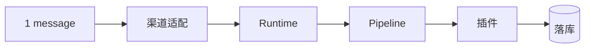
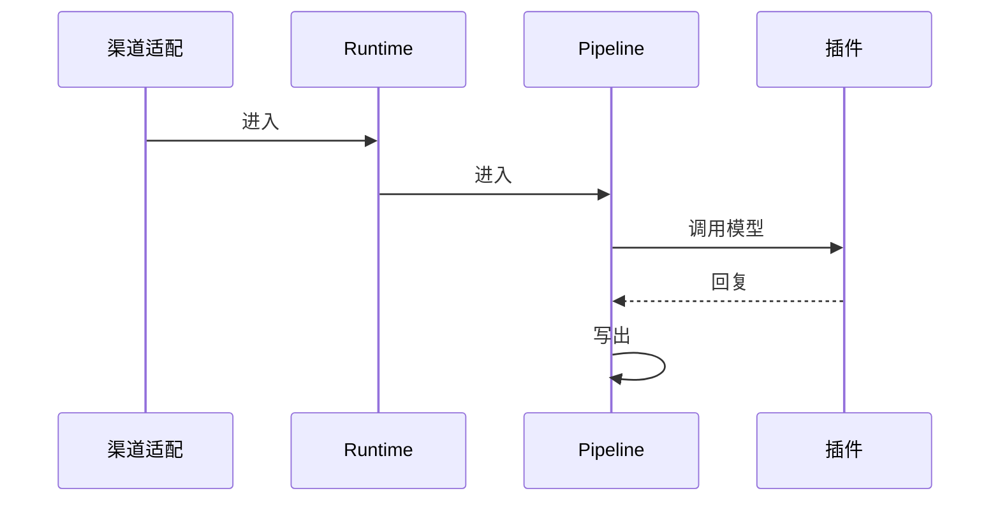

# Omnivuli

**Connect every channel. Evolve every conversation.**

<p align="center">
  <a href="./ORIGIN.md">Origin</a> ·
  <a href="./docs/01-product/01-requirements-specification.md">Requirements</a> ·
  <a href="./docs/README.md">Documentation</a> ·
  <a href="./DEVELOPMENT_PLAN.md">Roadmap</a> ·
  <a href="./docs/02-system-design/02-cicd-deployment.md">CI/CD</a> ·
  <a href="./CONTRIBUTING.md">Contributing</a> ·
  <a href="./COMMERCIAL-LICENSE.md">Commercial license</a>
</p>

<p align="center">
  <a href="./LICENSE"></a>
  <a href="./docs/README.md"></a>
  <a href="./CONTRIBUTING.md"></a>
</p>

<p align="center">
  <a href="./README.md"></a>
</p>

Omnivuli is a **composable conversation runtime**: an open, self-hostable **tool** for messaging pipelines (receive → process → act), extended with **L1 plugins** (channels, engines, handoff, actions) to build **domain-specific operations platforms**—not a one-size-fits-all SaaS console first.

**MVP default:** [`omnivuli-mvp`](./config/distribution/omnivuli-mvp.yaml) profile + [`plugin-engine-llm`](./packages/plugin-engine-llm/) (mock provider) — **no live Dify or Chatwoot** for the Sim demo loop. Optional production engine: [`omnivuli-standard`](./config/distribution/omnivuli-standard.yaml) + `plugin-engine-llm[dify]`. **Human agent ops:** Console Agent Desk + Runtime core Handoff (no Chatwoot plugin).

**Product model:** **Conversation Runtime** (tool) in [`apps/conversation-runtime`](./apps/conversation-runtime/) → **composition** via [`packages/`](./packages/) plugins and distribution profiles → **platform** for a vertical (optional admin console, multi-tenant RBAC, audit). IM channels (Telegram, LINE, WhatsApp, …) are **ingress plugins**, not the product definition.

**Project origin & why:** [ORIGIN.md](./ORIGIN.md) · **Decisions:** [DECISIONS.md](./DECISIONS.md)

## Minimal path

ASAIR fused channels, the workflow engine, and the operator inbox into one stack hard-wired to Dify and Chatwoot. Omnivuli splits that into Runtime (`apps/conversation-runtime`), Pipeline (`apps/conversation-runtime/app/pipeline`), and plugins (`packages/plugin-ingress-messaging`, `packages/plugin-engine-llm`). The path that runs today is one Telegram account message into Runtime, through `TelegramAccountMessagePipeline`, into the Dify engine registered by `plugin-engine-llm`, then `ConversationHistoryService.save_message` (Redis and PostgreSQL).

One channel, one message, one plugin, one model. RAG is not on this path.



| Name | Directory |
| ---- | --------- |
| 渠道适配 | `packages/plugin-ingress-messaging` registers the ingress slot. Live Telegram **account** traffic is Telethon under `apps/conversation-runtime/app/pipeline/account/telegram` (the package marks `telegram_account` as a placeholder). |
| Runtime | `apps/conversation-runtime` |
| Pipeline | `apps/conversation-runtime/app/pipeline` — class `TelegramAccountMessagePipeline` |
| 插件 | `packages/plugin-engine-llm` registers `DifyEngine`. This pipeline calls `EngineManager.invoke_dify_chat`, which accepts only that engine (the mock provider is not on this path). |



- **会话锁：** `SessionLockService.is_locked` is true, or auto-reply is off, so Pipeline returns before the model call and sends nothing (`message_pipeline.py`).
- **去重：** `dedupe_key` is described in the Bot channel spec and is not implemented on this path. The same conversation is kept to one in-flight turn by Redis `SET NX` on `pipeline:processing:{app_id}:{conversation_id}`; a missed lock is requeued once, and a second miss skips the turn.
- **失败后的下一步：** After limited retries, `DifyClient` returns `status=fallback` with a fixed message, and Pipeline sends that text. If the session is locked after the model returns, or there is no reply text, Pipeline deletes the processing key and returns without sending.

**Reliability:** one number, shared with the resume. Not measured on this path yet. When measured, replace this sentence with successes / sends and the window (at least 100 sends). Do not use the performance-test target in `apps/conversation-runtime/tests/performance/README.md`.

Voiceover, in order: one Telegram message, 渠道适配, Runtime, Pipeline, 插件, one model, 落库. Read the reliability sentence only after the fraction above is filled in.

## Roadmap

Not on the path above: multi-tenant Console, further channels, and Agent desk (human takeover). Active order: [`DEVELOPMENT_PLAN.md`](./DEVELOPMENT_PLAN.md).

## Naming: Conversation Runtime

| Term | Meaning |
| ---- | ------- |
| **Conversation Runtime** | Product/architecture name for the L0 execution tool (`receive → process → act`) |
| **`apps/conversation-runtime`** | Repository path for the runtime |

**Core differentiator:** a governed **human + AI collaboration** model—automation per end user (default off), handoff to operators, clear message attribution, and processing vs. action separation—suited to B2B customer operations rather than personal assistant use cases.

This repository is the **Omnivuli monorepo**: runtime and admin apps, plugin packages, canonical documentation, marketing site, and optional local stacks for third-party services.

## Repository map (30 seconds)

| I want to… | Go to |
| ---------- | ----- |
| Understand why / origin | [`ORIGIN.md`](./ORIGIN.md) |
| Run MVP Sim demo (no Dify key) | [`examples/local-dev`](./examples/local-dev/) |
| Change pipelines / Bot / engines | [`apps/conversation-runtime`](./apps/conversation-runtime/) |
| Change tenant admin / Console UI | [`apps/conversation-console`](./apps/conversation-console/) |
| Read product or API specs | [`docs/`](./docs/) |
| Track field MVP / out-of-MVP | [`DEVELOPMENT_PLAN.md`](./DEVELOPMENT_PLAN.md) |
| Run Phase 1 Telegram + Dify demo | [`examples/phase1-telegram`](./examples/phase1-telegram/) |

Full directory guide: **[`REPO.md`](./REPO.md)** (layers, `examples/` vs `externals/`, what to skip).

## Quick start

**Recommended for MVP:** unified **Console + Runtime + Conversation Simulator** stack — no external API keys when using `omnivuli-mvp`. See [`examples/local-dev`](./examples/local-dev/) and [`DEVELOPMENT_PLAN.md`](./DEVELOPMENT_PLAN.md).

For Runtime-only or Phase 1 Telegram + optional Dify/Chatwoot, use the sections below.

> Before running apps locally, ensure your machine meets the following baseline:
>
> - **Node.js** 18+ (20+ recommended) for frontends and `website/`
> - **Python** 3.10+ for `apps/conversation-runtime`; Python 3.x for `apps/conversation-console/backend`
> - **PostgreSQL** and **Redis** when exercising full stacks (local install or Docker)

<br/>

#### MVP demo — Console + Runtime + Simulator ([`examples/local-dev`](./examples/local-dev/))

```bash
cd Omnivuli/examples/local-dev
cp .env.example .env
# OMNIVULI_DISTRIBUTION_PROFILE=omnivuli-mvp is default — mock engine, no Dify/Chatwoot keys

docker compose --profile sim up -d --build --wait
```

| Surface | URL |
| ------- | --- |
| Console UI | http://localhost:9080 |
| Sim Playground | http://localhost:9300 |
| Runtime health | http://localhost:8000/health |

Operator flow: Console → Bot Flow → **模拟客服** (`ingress_sim`) → **在 Sim 中打开** → send message → mock engine reply. Details: [`examples/local-dev/README.md`](./examples/local-dev/README.md).

<br/>

#### Conversation Runtime only — [`apps/conversation-runtime`](./apps/conversation-runtime/)

```bash
git clone <repository-url>
cd Omnivuli/apps/conversation-runtime
python3 -m venv .venv && source .venv/bin/activate
pip install -U pip && pip install .
# MVP: also install mock engine + telegram ingress plugins
# pip install -e '../../packages/plugin-engine-llm' -e ../../packages/plugin-ingress-messaging
cp .env.example .env
docker run -d -p 6379:6379 redis   # Redis required
./scripts/dev.sh
```

Health check: `GET http://localhost:8000/health` · API docs: `/swagger`.


#### Phase 1 (~30 min) Telegram deploy (AI + Bot, optional Dify / Chatwoot)

Use the ready recipe under [`examples/phase1-telegram`](./examples/phase1-telegram/) with profile **`omnivuli-standard`** and external keys:

```bash
cd Omnivuli/examples/phase1-telegram
cp .env.example .env
# Fill DIFY_API_KEY and optional Chatwoot/Telegram fields

docker compose up -d --build
curl http://localhost:8000/health
```

Then run both Telegram paths:

- **Bot 客服 (Telegram Bot API):** register channel -> `POST /api/v1/bot/channels/register`, then webhook `POST /api/v1/bot/webhook/{webhook_path_token}`
- **AI 客服 (Telegram private account):** register account -> `POST /api/v1/telegram/accounts`, then `POST /api/v1/telegram/reload`

#### Conversation Console (optional — platform / multi-tenant control plane)

```bash
cd Omnivuli/apps/conversation-console
cp .env.example .env
docker compose up -d db redis

# Terminal A — API
cd backend && python -m venv venv && source venv/bin/activate
pip install -r requirements.txt
python src/run.py   # http://localhost:8100/api/v1/healthz

# Terminal B — UI (Vite dev)
cd ../frontend && pnpm install && pnpm dev   # http://localhost:9099
```

#### Optional: Chatwoot locally

See [`externals/chatwoot/`](./externals/chatwoot/) for compose and `env.example`. Production deployments may use hosted Chatwoot instead.

#### Seeking help

- Per-app setup: [`apps/conversation-console/README.md`](./apps/conversation-console/README.md), [`apps/conversation-runtime/README.md`](./apps/conversation-runtime/README.md)
- Engineering docs: [`docs/README.md`](./docs/README.md) and [`docs/02-system-design/`](./docs/02-system-design/)
- Issues and contributions: [Contributing](./CONTRIBUTING.md)

## Product model: tool → composition → platform

| Layer | What it is | In this repo |
| ----- | ---------- | ------------ |
| **Tool** | **Conversation Runtime**: contracts, registries, orchestration (`receive → process → act`) | [`apps/conversation-runtime`](./apps/conversation-runtime/) |
| **Composition** | Official L1 plugins + distribution profiles (`omnivuli-mvp`, `omnivuli-standard`) | [`packages/`](./packages/), [`config/distribution/`](./config/distribution/) |
| **Platform** | A deployable stack for a **specific business domain** (optional admin, tenants, RBAC, audit) | `apps/conversation-console` + chosen plugins |

Plugins are discovered via Python **`entry_points`** and enabled by configuration at process startup—not arbitrary tenant-uploaded code.

## Key features

**1. Composable runtime (tool-first)**  
Stable pipeline contracts (`NormalizedEvent`, `Conclusion`, `ActionPlan`), pluggable ingress/engines/actions. MVP ships **`plugin-engine-llm`** (mock); production may enable **Dify** via `plugin-engine-llm[dify]`. Spec: [Runtime contracts](./apps/conversation-runtime/docs/api/contracts.md).

**2. Human + AI collaboration**  
Enable automation per end user (default off), switch AI ↔ human processing via **Console Agent Desk** and Runtime session lock — not Chatwoot. See [`DECISIONS.md`](./DECISIONS.md).

**3. Plugins and integrations**  
Channels (e.g. Telegram, LINE), workflow engines (**mock** or **Dify**), seat/inbox sync, and domain **`plugin-action-*`** hooks—compose into recipes via distribution profiles.

**4. Multi-tenant control plane (when needed)**  
Optional admin console: platform vs. tenant RBAC, quotas, bot flows, AI profiles—see [requirements spec](./docs/01-product/01-requirements-specification.md).

**5. Observable operations**  
User interaction status, insight signals for triage, and artifact-driven CI/CD ([deployment design](./docs/02-system-design/02-cicd-deployment.md)).

## Using Omnivuli

- **Local development**  
  Run individual apps under `apps/` as in [Quick start](#quick-start). Prefer small PRs aligned with [`docs/`](./docs/).

- **Documentation-driven design**  
  Canonical specs live under **`docs/`** ([docs policy](./docs/README.md)).

- **Deployment**  
  Use root [GitHub Actions workflows](./.github/workflows/) (`workflow_dispatch`). **Build-only** runs upload artifacts without environment secrets; enable **Deploy to selected environment** for SSH deploy to `production` / `staging` / `server-dev`. See [CI/CD design](./docs/02-system-design/02-cicd-deployment.md).

- **Commercial use**  
  AGPL-3.0 applies to open-source use in compliance with the license. For proprietary or AGPL-incompatible models, see [COMMERCIAL-LICENSE.md](./COMMERCIAL-LICENSE.md).

## Repository layout

See **[`REPO.md`](./REPO.md)** for the full map. Summary:

```text
Omnivuli/
├── apps/                    # conversation-runtime, console, model-training, conversation-simulator
├── packages/                # L1 plugins
├── config/distribution/     # Startup profiles (omnivuli-mvp, omnivuli-standard)
├── docs/                 # Canonical specs
├── examples/                # local-dev (MVP), phase1-telegram (standard profile)
├── externals/               # Optional Chatwoot/Dify stacks
└── website/                 # Marketing (not the admin product)
```

| Area | Stack | Path |
|------|--------|------|
| **Conversation Runtime** | FastAPI, async SQLAlchemy, Redis, Engine Contract | `apps/conversation-runtime` |
| **Plugins** | Python packages, `entry_points` | `packages/` |
| **Console UI** | React 18, Vite, React Router, Zustand, i18next | `apps/conversation-console/frontend` |
| **Console API** | Flask, SQLAlchemy, Alembic, JWT | `apps/conversation-console/backend` |
| Marketing | Next.js | `website/` |
| Data | PostgreSQL; Redis where required | per-app config |
| Docs | Markdown + Mermaid | `docs/` |

## AI-assisted development

| Topic | Entry |
|--------|--------|
| Development roadmap | [`DEVELOPMENT_PLAN.md`](./DEVELOPMENT_PLAN.md) |
| Agent instructions (monorepo) | [`AGENTS.md`](./AGENTS.md) |
| Conversation Runtime agent guide | [`apps/conversation-runtime/AGENTS.md`](./apps/conversation-runtime/AGENTS.md) |
| Conversation Console agent guide | [`apps/conversation-console/AGENTS.md`](./apps/conversation-console/AGENTS.md) |
| Plugin layout | [`packages/README.md`](./packages/README.md) |
| Cursor skills | [`.cursor/skills/`](./.cursor/skills/) |

## Documentation

| Topic | Entry |
|--------|--------|
| Origin & why | [`ORIGIN.md`](./ORIGIN.md) |
| Architecture decisions | [`DECISIONS.md`](./DECISIONS.md) |
| Index & locale policy | [`docs/README.md`](./docs/README.md) |
| Requirements | [`docs/01-product/01-requirements-specification.md`](./docs/01-product/01-requirements-specification.md) |
| Architecture | [`docs/02-system-design/01-system-architecture.md`](./docs/02-system-design/01-system-architecture.md) |
| Database | [`apps/conversation-console/docs/database-design.md`](./apps/conversation-console/docs/database-design.md) |
| Admin API | [`apps/conversation-console/docs/api/backend-api.md`](./apps/conversation-console/docs/api/backend-api.md) |
| Conversation Runtime API | [`apps/conversation-runtime/docs/api/runtime-api.md`](./apps/conversation-runtime/docs/api/runtime-api.md) *(filename legacy)* |
| **Runtime contracts (L0)** | [`apps/conversation-runtime/docs/api/contracts.md`](./apps/conversation-runtime/docs/api/contracts.md) |
| CI/CD & deploy | [`docs/02-system-design/02-cicd-deployment.md`](./docs/02-system-design/02-cicd-deployment.md) |

## Contributing

We welcome issues and pull requests. Read [**CONTRIBUTING.md**](./CONTRIBUTING.md) for monorepo workflow, commit conventions, documentation mirroring, and CI/CD behavior. App-specific guides: [`apps/conversation-console/CONTRIBUTING.md`](./apps/conversation-console/CONTRIBUTING.md), [`apps/conversation-runtime/CONTRIBUTING.md`](./apps/conversation-runtime/CONTRIBUTING.md).

## Project origin

See **[ORIGIN.md](./ORIGIN.md)** (why, ASAIR background, design principles) and **[DECISIONS.md](./DECISIONS.md)** (recorded architecture choices).

## Brand

- **Name:** Omnivuli — *Omni* (all channels) + *uli* (product family suffix).
- **Tagline:** Connect every channel. Evolve every conversation.  
  （打通每个渠道，进化每次对话。）
- **Positioning:** Composable conversation runtime—**tool first**, **L1 plugins** to build **domain platforms**; MVP validates the loop without mandatory third-party orchestration; AI and human operators collaborate on the same customer thread when handoff plugins are enabled.

## Security

Do not commit secrets (`.env`, API keys, deploy keys). Use `.env.example` and GitHub Environment secrets for deployment. Report security issues through your organization’s preferred private channel rather than public issues when exploitation is possible.

## License

The repository root [`LICENSE`](./LICENSE) is the **unmodified AGPL-3.0** text (GitHub **AGPL-3.0** badge). **Dual licensing:**

| Path | Terms |
|------|--------|
| **Open source** | [**GNU Affero General Public License v3.0**](./LICENSE) (AGPL-3.0). No license fee when use, modification, and distribution **comply** with the AGPL. |
| **Commercial / proprietary** | Paid [**COMMERCIAL-LICENSE.md**](./COMMERCIAL-LICENSE.md) when AGPL obligations are not acceptable (e.g. certain closed-source or SaaS models). |

This is not legal advice. Consult counsel for material decisions.
