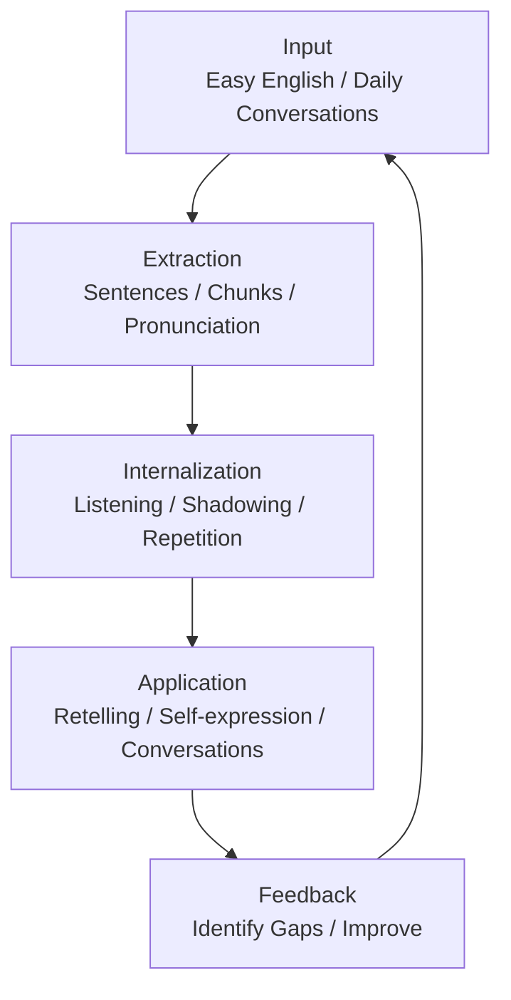

> **补充日常英语能力，建立自然、流畅的 Everyday Communication 能力。**

## 1. Background & Objectives

### 1.1 Background

过去的英语学习主要集中在 Academic English，包括：

- IELTS Listening / Reading / Writing / Speaking
- BBC News、TED 等内容
- Academic Vocabulary
- Complex Sentences
- Formal Expressions
- Argumentation

虽然这些学习能够帮助理解复杂信息和进行正式表达，但日常交流所需的语言能力仍然需要补充。

例如：

- 日常寒暄和社交互动
- 商店、餐厅、交通等生活场景
- 表达个人喜好、态度和感受
- 询问、回应、解释和补充信息
- 自然地参与日常对话

因此，需要增加 General English 的学习模块。

### 1.2 Learning Objectives

核心目标：

> Develop natural, fluent and practical everyday communication skills.

具体包括：

1. **Listening Comprehension**：能够理解真实生活中的日常英语交流。
2. **Conversational Expressions**：掌握自然、高频的日常表达。
3. **Natural Pronunciation**：熟悉连读、弱读、重音和语调。
4. **Spontaneous Speaking**：能够根据实际场景快速组织语言。
5. **Social Interaction**：能够自然地参与日常社交和互动。

### 1.3 Academic English vs General English

| Dimension | Academic English | General English |
|---|---|---|
| Core Purpose | Formal & Academic Communication | Everyday Communication |
| Vocabulary | Academic Vocabulary | Daily Vocabulary |
| Expressions | Formal Expressions | Conversational Expressions |
| Sentences | Complex Sentences | Common Sentence Patterns |
| Listening | News, Lectures, Talks | Daily Conversations |
| Speaking | Argumentation, Explanation | Interaction, Response |
| Key Ability | Accuracy & Depth | Naturalness & Fluency |

两者并非相互独立，而是共同构成完整的英语能力体系。

---

## 2. Learning Materials

### 2.1 Primary Input

当前主要使用 Easy English 视频作为 General English 的输入来源。

学习时优先选择：

- Street Interviews
- Everyday Conversations
- Daily Life Topics
- Social Interactions
- Real-life Situations

选择材料时，优先考虑真实、自然、有实际交流价值的内容。

### 2.2 Learning Principles

不采用传统的逐句精读模式：

> Play Video → Read Subtitles → Translate → Look Up Words → Take Notes

这种方式容易将视频变成阅读材料，忽视真实交流中的语言理解和即时反应。

新的学习原则：

- Understand first：优先理解整体内容。
- Discover expressions：主动发现自然表达。
- Extract selectively：只提取有价值的内容。
- Internalize：通过听和跟读建立熟悉度。
- Apply：将表达迁移到自己的生活中。

---

## 3. Video Learning Workflow

每个视频采用三个阶段处理。

### Stage 1. Understand

**第一遍：不暂停，尽量不看字幕。**

目标：理解视频整体内容。

关注：

- What is the topic?
- What are they talking about?
- What is happening?
- What is the relationship between the speakers?
- Can I understand the general meaning?

注意：

- 不需要听懂每一个单词。
- 不要因为个别表达不理解而频繁暂停。
- 优先建立整体语境。

### Stage 2. Discover

**第二遍：开启英文字幕，观察表达方式。**

重点寻找以下内容：

| Category | Description | Example |
|---|---|---|
| Daily Expressions | 高频日常表达 | How's it going? |
| Conversational Chunks | 固定表达组合 | I'm looking forward to it. |
| Phrasal Verbs | 常见短语动词 | Run into someone |
| Natural Responses | 自然回应方式 | That makes sense. |
| Interaction | 对话衔接方式 | By the way, actually... |

特别关注：

- 如何回应别人的问题？
- 如何表达赞同或反对？
- 如何自然地补充信息？
- 如何表达犹豫、惊讶和不确定？
- 如何延续一段对话？

**筛选原则：每个视频最多关注 5～10 个表达，不追求全部提取。**

### Stage 3. Internalize

**第三遍：选择重点片段进行跟读和复述。**

#### 3.1 Shadowing

选择 2～3 个片段：

1. 听原音。
2. 模仿语音、语调和节奏。
3. 关注连读、弱读和停顿。
4. 重复练习，直到能够比较自然地说出来。

重点不是模仿口音，而是建立自然的发音习惯。

#### 3.2 Retelling

不看字幕，用自己的话复述视频内容。

例如，视频讨论周末活动：

- 描述自己周末通常做什么。
- 分享自己喜欢的活动。
- 解释为什么喜欢这些活动。
- 尝试使用刚刚学到的表达。

不要求复述原文，重点是将输入内容迁移到自己的表达中。

---

## 4. Knowledge Extraction

继续沿用现有 Sentence System，不额外建立一套独立的知识体系。

但需要增加 General English 的筛选标准。

### 4.1 Sentence

核心积累对象：完整、自然、具有实际使用价值的句子。

Examples:

- I'm just looking around, thanks.
- I haven't really thought about it.
- I was wondering if you could help me.
- It's not really my thing.
- I've been meaning to try that for a while.

筛选标准：

1. Everyday Usability：日常生活中是否能够使用？
2. Frequency：是否属于常见表达？
3. Naturalness：是否自然、符合真实交流习惯？
4. Transferability：是否能够迁移到不同场景？
5. Practical Value：是否具有实际交流价值？

优先保留完整句子，而不是单独记录大量单词。

### 4.2 Chunks

关注值得单独记忆的表达片段。

| Chunk | Function |
|---|---|
| I'm just wondering... | 委婉地提出疑问 |
| It depends on... | 表达取决于某个条件 |
| As far as I know... | 根据目前所了解的情况 |
| I was about to... | 表达正准备做某事 |
| I don't really mind. | 表达自己并不介意 |

Chunks 不需要建立独立卡片体系。

可以作为 Sentence 的属性，或者与对应 Sentence 建立关联。

### 4.3 Pronunciation

关注自然发音：

- Linking：连读
- Weak Forms：弱读
- Intonation：语调
- Sentence Stress：句子重音
- Connected Speech：连续语流

特别注意：

> 能够看懂一个句子，不代表能够听懂别人自然地说出这个句子。

因此，对于有价值的表达，尽可能保留原始音频。

### 4.4 Sentence Data Structure

继续沿用现有字段：

| Field | Description |
|---|---|
| Sentence | 完整句子 |
| Audio | 原视频音频 |
| Translation | 准确理解句子含义 |
| Pattern | 句型结构、可替换部分 |
| Function | 具体交际功能 |
| Exam | 是否适用于 IELTS（可选） |
| Suitable for | 适用的生活场景 |
| Related | 相关表达 |

重点补充两个字段：

**Function**

记录表达在交流中起到的作用。

例如：

Sentence: I'm wondering if you could help me.

Function:
- Making a polite request
- Softening a question
- Asking for assistance

**Suitable for**

记录可以使用该表达的场景。

例如：

- Asking for help
- Talking to strangers
- Workplace communication
- Everyday conversation

---

## 5. Learning Schedule

不建议每个视频都进行大量精读。

### 5.1 Single Video Workflow

建议每个视频投入约 30～40 分钟，根据视频长度和内容难度灵活调整。

| Stage | Time | Activity |
|---|---:|---|
| Understand | 5 min | 不看字幕，理解整体内容 |
| Discover | 10–15 min | 开启字幕，发现值得学习的表达 |
| Extract | 5–10 min | 选择 3～5 个高价值句子 |
| Shadowing | 5 min | 模仿语音、语调和节奏 |
| Retelling | 5 min | 使用自己的语言复述 |

以上时间不是必须完成的指标。

宁愿掌握 3 个高质量表达，也不要为了数量整理 20 个没有真正使用过的句子。

### 5.2 Weekly Structure

| Activity | Frequency | Purpose |
|---|---:|---|
| Easy English Videos | 4–5 times/week | 日常表达输入 |
| Sentence Extraction | 随视频进行 | 建立表达储备 |
| Shadowing | 4–5 times/week | 自然发音 |
| Free Speaking | 3 times/week | 实际调用 |
| Sentence Review | 2 times/week | 巩固与复习 |

先进行两周实验，再根据实际效果调整。

---

## 6. Learning Evaluation

需要区分三个学习阶段。

### Level 1. Recognition

**认识**

- 听到表达时能够理解意思。
- 看到句子时能够准确理解。
- 熟悉表达的使用场景。

### Level 2. Reproduction

**复现**

- 能够跟读。
- 能够模仿语音和语调。
- 在提示下能够说出表达。

### Level 3. Application

**应用**

- 没有提示也能够调用表达。
- 能够根据实际场景使用。
- 能够将表达迁移到不同的交流环境。

最终目标是 Level 3。

Example:

学习表达：

`I'm not really into ...`

尝试迁移：

- I'm not really into horror movies.
- I'm not really into shopping.
- I'm not really into competitive games.

真正掌握一个表达，不只是理解它，而是能够在适当的场景中自然使用它。

---

## 7. General English Learning Principles

避免将 Academic English 的学习习惯完全照搬到 General English。

例如：

看到一个句子，不一定需要：

- 深入分析所有语法结构。
- 查询每个单词的词源。
- 分析复杂句式。
- 研究是否适用于 IELTS Writing。

对于日常表达，优先回答：

1. What does it mean?
2. When can I use it?
3. How do people naturally say it?
4. Can I understand it immediately?
5. Can I use it in a real conversation?

核心训练方向：

**Retrieval & Application**

提高表达的调用能力，而不是单纯增加知识分析的深度。

---

## 8. General English Learning Loop

整个学习体系采用持续反馈的闭环：

核心逻辑：

- Input：接触真实的日常英语。
- Extraction：筛选有价值的表达。
- Internalization：通过听和跟读建立熟悉度。
- Application：在实际场景中使用。
- Feedback：发现表达和理解上的不足。

---

## 9. Pending Discussions

以下问题暂时不需要立即确定，先通过实际学习进行验证。

### 9.1 Video Processing Depth

视频究竟应该处理到什么程度？

初步倾向：

- 理解为主。
- 提取为辅。
- 输出作为验证。

不需要将每个视频都变成精读材料。

### 9.2 Sentence Selection Criteria

General English 的 Sentence 应该侧重：

- 高频使用。
- 自然表达。
- 可迁移性。
- 实际交流价值。

而不是单纯追求生词量或句子复杂度。

### 9.3 Scenario Classification

是否需要建立场景分类？

初步考虑：

- Shopping
- Restaurant
- Transportation
- Travel
- Socializing
- Workplace
- Daily Life

初步倾向：暂时不建立庞大的分类体系，先积累真实表达，再根据实际内容自然形成分类。

---

## 10. Next Step

暂时不急于确定最终学习体系。

建议先选择正在观看的 Easy English 视频，按照本方案进行一次实际处理。

通过真实学习反馈验证：

1. 视频观看流程是否合理？
2. 每个视频应该提取多少内容？
3. Sentence 的筛选标准是否合适？
4. Shadowing 和 Retelling 是否有效？
5. 是否需要调整现有 Sentence System？

**最终目标：补齐 Everyday Communication Layer，让英语从理解复杂信息的工具，进一步成为能够自然应用于日常生活的交流工具。**